# Google Cloud CX Agent Studio — `cxas-scrapi` & Claude Code 실무 기술 가이드 (비전공자·초보자 맞춤형)

<p align="center">
  
</p>

> **문서 개요**: 본 가이드는 IT 개발 경험이나 코딩에 익숙하지 않은 고객사 담당자분들도 **Google Cloud CX Agent Studio (GECX / CES)** 의 AI 상담원을 내 컴퓨터로 안전하게 내려받아 관리하고, **클로드 코드(Claude Code)** 에게 **한국어(자연어)로 지시하여 AI 상담원을 제작·수정·자동 테스트·배포**할 수 있도록 단계별로 안내하는 실무 기술 가이드입니다.
>
> 화면에 나와 있는 명령어를 **위에서부터 순서대로 복사·붙여넣기**만 하면 누구나 15분 안에 세팅을 완료할 수 있도록 구성되어 있습니다.

---

## 📑 목차 (Table of Contents)

1. [CXAS SCRAPI란 무엇인가요? (비개발자를 위한 3분 요약)](#1-cxas-scrapi란-무엇인가요-비개발자를-위한-3분-요약)
   - [1.1 왜 웹 화면(콘솔)에서만 작업하면 불편할까요?](#11-왜-웹-화면콘솔에서만-작업하면-불편할까요)
   - [1.2 CXAS SCRAPI + 클로드 코드(Claude Code)를 쓰면 무엇이 좋아지나요?](#12-cxas-scrapi--클로드-코드claude-code를-쓰면-무엇이-좋아지나요)
   - [1.3 꼭 알아두어야 할 핵심 용어 6가지 (쉬운 비유 사전)](#13-꼭-알아두어야-할-핵심-용어-6가지-쉬운-비유-사전)
2. [사전 준비 1단계: 전용 작업실(가상환경) 세팅 및 CXAS SCRAPI 설치하기](#2-사전-준비-1단계-전용-작업실가상환경-세팅-및-cxas-scrapi-설치하기)
   - [Step 2.1: 명령어 입력창(터미널 / PowerShell) 열기](#step-21-명령어-입력창터미널--powershell-열기)
   - [Step 2.2: 필수 프로그램 3가지 설치 여부 확인하기](#step-22-필수-프로그램-3가지-설치-여부-확인하기)
   - [Step 2.3: 작업용 새 폴더 만들고 파이썬 가상환경(`.venv`) 먼저 세팅하기](#step-23-작업용-새-폴더-만들고-파이썬-가상환경venv-먼저-세팅하기)
   - [Step 2.4: `cxas-scrapi` 설치 및 클로드 코드 AI 스킬(`cxas init`) 장착하기](#step-24-cxas-scrapi-설치-및-클로드-코드-ai-스킬cxas-init-장착하기)
3. [사전 준비 2단계: Google Cloud 콘솔(웹) 확인 및 `gcloud` 로그인하기](#3-사전-준비-2단계-google-cloud-콘솔웹-확인-및-gcloud-로그인하기)
   - [Step 3.1: Google Cloud 웹 콘솔에서 `프로젝트 ID`와 `권한(IAM)` 확인하기](#step-31-google-cloud-웹-콘솔에서-프로젝트-id와-권한iam-확인하기)
   - [Step 3.2: CX Agent Studio 웹 콘솔에서 내 에이전트 앱(App) 확인하기](#step-32-cx-agent-studio-웹-콘솔에서-내-에이전트-앱app-확인하기)
   - [Step 3.3: 터미널에서 구글 계정 연동 로그인하기 (`gcloud auth`)](#step-33-터미널에서-구글-계정-연동-로그인하기-gcloud-auth)
   - [Step 3.4: 연결이 잘 되었는지 10초 만에 확인하기](#step-34-연결이-잘-되었는지-10초-만에-확인하기)
4. [클로드 코드(Claude Code) 시작하기 및 프로젝트 명찰(`gecx-config.json`) 만들기](#4-클로드-코드claude-code-시작하기-및-프로젝트-명찰gecx-configjson-만들기)
   - [Step 4.1: 가상환경이 켜진 상태에서 클로드 코드 실행하기](#step-41-가상환경이-켜진-상태에서-클로드-코드-실행하기)
   - [Step 4.2: 클로드 코드에게 말해서 프로젝트 설정 파일(`gecx-config.json`) 자동 생성하기](#step-42-클로드-코드에게-말해서-프로젝트-설정-파일gecx-configjson-자동-생성하기)
5. [실전 시나리오 ①: 콘솔의 기존 AI 상담원 가져와서 수정·검수·배포하기 (Pull → Edit → Lint → Push)](#5-실전-시나리오--콘솔의-기존-ai-상담원-가져와서-수정검수배포하기-pull--edit--lint--push)
   - [Step 5.1: 웹 콘솔의 상담원을 내 컴퓨터로 다운로드하기 (`cxas pull`)](#step-51-웹-콘솔의-상담원을-내-컴퓨터로-다운로드하기-cxas-pull)
   - [Step 5.2: 다운로드된 폴더 구조 이해하기 (딱 3가지만 기억하세요!)](#step-52-다운로드된-폴더-구조-이해하기-딱-3가지만-기억하세요)
   - [Step 5.3: 클로드 코드에게 한국어로 지시하여 상담원 매뉴얼 및 도구 수정하기](#step-53-클로드-코드에게-한국어로-지시하여-상담원-매뉴얼-및-도구-수정하기)
   - [Step 5.4: 배포 전 오타·규칙 위반 자동 검사하기 (`cxas lint` & `cxas llm-lint`)](#step-54-배포-전-오타규칙-위반-자동-검사하기-cxas-lint--cxas-llm-lint)
   - [Step 5.5: 안전 백업(버전 스냅샷) 생성 후 웹 콘솔에 업로드하기 (`cxas push`)](#step-55-안전-백업버전-스냅샷-생성-후-웹-콘솔에-업로드하기-cxas-push)
6. [실전 시나리오 ②: 클로드 코드에게 한국어로 시켜 신규 AI 상담원 제작 및 자동 평가·디버깅하기 (`cxas-agent-foundry`)](#6-실전-시나리오--클로드-코드에게-한국어로-시켜-신규-ai-상담원-제작-및-자동-평가디버깅하기-cxas-agent-foundry)
   - [6.1 클로드 코드의 만능 비서 `cxas-agent-foundry`란?](#61-클로드-코드의-만능-비서-cxas-agent-foundry란)
   - [Step 6.1 (Build): 한국어 기획서(요구사항)로 신규 상담원 통째로 만들기](#step-61-build-한국어-기획서요구사항로-신규-상담원-통째로-만들기)
   - [Step 6.2 (Run): 5가지 자동 모의고사(Evaluations) 돌리고 성적표 받기](#step-62-run-5가지-자동-모의고사evaluations-돌리고-성적표-받기)
   - [Step 6.3 (Debug): 틀린 문제를 클로드 코드가 스스로 분석하고 고치게 시키기](#step-63-debug-틀린-문제를-클로드-코드가-스스로-분석하고-고치게-시키기)
7. [안전한 실무 운영을 위한 고급 활용법 (연습장 복제, 통화 추적, VS Code 화면 도구)](#7-안전한-실무-운영을-위한-고급-활용법-연습장-복제-통화-추적-vs-code-화면-도구)
   - [7.1 운영 중인 상담원을 건드리지 않고 쌍둥이 연습장 만들기 (`cxas branch`)](#71-운영-중인-상담원을-건드리지-않고-쌍둥이-연습장-만들기-cxas-branch)
   - [7.2 고객과의 과거 대화 녹취·로그 족집게 분석하기 (`cxas trace`)](#72-고객과의-과거-대화-녹취로그-족집게-분석하기-cxas-trace)
   - [7.3 (선택) 마우스 클릭만으로 작업하고 싶다면? VS Code 확장 프로그램 활용](#73-선택-마우스-클릭만으로-작업하고-싶다면-vs-code-확장-프로그램-활용)
8. [자주 묻는 질문 및 1분 에러 해결집 (Troubleshooting FAQ)](#8-자주-묻는-질문-및-1분-에러-해결집-troubleshooting-faq)
9. [부록: 모니터 옆에 붙여두고 쓰는 클로드 코드 프롬프트 & 명령어 컨닝 페이퍼](#9-부록-모니터-옆에-붙여두고-쓰는-클로드-코드-프롬프트--명령어-컨닝-페이퍼)

---

## 1. CXAS SCRAPI란 무엇인가요? (비개발자를 위한 3분 요약)

### 1.1 왜 웹 화면(콘솔)에서만 작업하면 불편할까요?

Google Cloud의 **CX Agent Studio (웹 콘솔)** 화면은 마우스로 AI 상담원을 만들고 설정하기에 매우 편리합니다. 하지만 실제 고객센터 서비스를 운영하다 보면 웹 화면만으로는 다음과 같은 어려움이 생깁니다:

| 웹 화면(콘솔)에서만 작업할 때의 고민 | 일상 비유 |
| :--- | :--- |
| **"실수로 지웠는데 되돌릴 수가 없어요!"**<br>웹 화면에서 상담원 지침(프롬프트)을 고치다가 실수로 중요한 문장을 지우고 저장하면, 예전 내용으로 감쪽같이 되돌리기가 어렵습니다. | 워드 문서를 `다른 이름으로 저장(백업)` 없이 원본 파일 하나에 계속 덮어쓰기만 하는 상황 |
| **"한 줄 고쳤는데 질문 50개를 또 손으로 쳐서 테스트해야 하나요?"**<br>안내 문구 하나를 바꿨을 때 기존에 잘 되던 주문 조회나 예약 취소가 망가지지 않았는지 일일이 채팅창에 손으로 입력하며 확인하기엔 시간이 너무 오래 걸립니다. | 시험 문제 채점을 정답지 기계 없이 선생님이 일일이 손으로 읽으며 채점하는 상황 |
| **"테스트방에서 만든 상담원을 실제 운영방으로 어떻게 옮기죠?"**<br>연습용 에이전트에서 테스트를 마친 뒤, 실제 고객이 접속하는 운영 에이전트에 똑같이 적용하려면 여러 메뉴를 일일이 복사·붙여넣기 해야 해서 실수가 발생하기 쉽습니다. | 새 매장 인테리어를 할 때 설계 도면 없이 옆 매장 사진을 보고 눈대중으로 똑같이 짓는 상황 |

---

### 1.2 CXAS SCRAPI + 클로드 코드(Claude Code)를 쓰면 무엇이 좋아지나요?

**CXAS SCRAPI (`cxas-scrapi`, CX Agent Studio Scripting API)** 는 Google Cloud가 공식 제공하는 **"AI 상담원 자동 관리 및 품질 검수 리모컨"** 입니다.

특히 이 도구를 AI 작업 비서인 **클로드 코드(Claude Code)** 와 연결하면, **복잡한 코딩이나 명령어를 외울 필요 없이 클로드 코드에게 한국어로 대화하듯 지시**하여 모든 작업을 자동으로 처리할 수 있습니다!

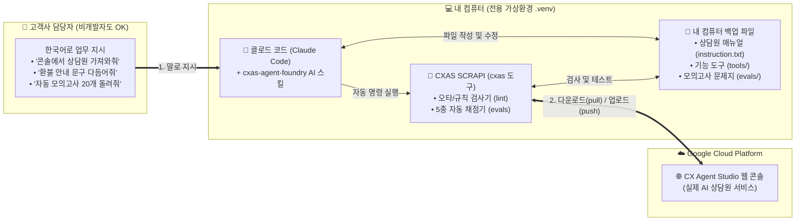

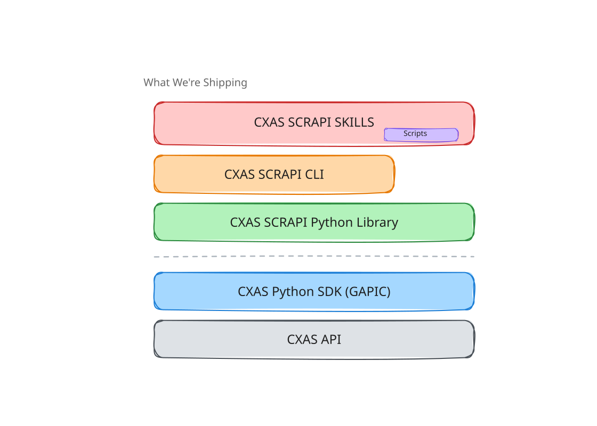

1. **내 컴퓨터에 안전한 설계도 파일로 백업 (`pull`)**: 웹 콘솔에 있는 AI 상담원의 모든 지침과 도구를 내 컴퓨터 폴더로 깔끔하게 다운로드합니다.
2. **클로드 코드에게 한국어로 수정 지시**: 파일을 직접 고칠 필요 없이, 클로드 코드에게 *"고객이 주문을 취소할 때 위약금 안내를 먼저 하도록 매뉴얼 수정해줘"* 라고 말하면 알아서 고쳐줍니다.
3. **배포 전 자동 맞춤법/안전 검사 (`lint`)**: 웹 콘솔에 올리기 전에 누락된 설정이나 문법 실수가 없는지 60가지 이상의 체크리스트로 1초 만에 자동 검사합니다.
4. **자동 모의고사 및 스스로 고치기 (`evals` & `debug`)**: AI 가상 고객이 우리 상담원과 수십 번 대화하며 점수를 매기고, 틀린 부분이 있으면 클로드 코드가 스스로 매뉴얼을 고쳐서 합격점(90% 이상)을 맞춥니다.

---

### 1.3 꼭 알아두어야 할 핵심 용어 6가지 (쉬운 비유 사전)

본 가이드를 읽으실 때 아래 6가지 단어만 가볍게 이해하시면 모든 내용이 술술 읽힙니다!

| 용어 | 쉬운 비유 | 설명 |
| :--- | :--- | :--- |
| **① 가상환경 (`.venv`)** | **칸막이가 쳐진 전용 작업실** | 내 컴퓨터에 이미 깔려 있는 다른 프로그램들과 섞이거나 충돌하지 않도록, 이번 AI 상담원 작업만을 위해 폴더 안에 만드는 깔끔한 독립 공간입니다. |
| **② App (앱) & Agent (에이전트)** | **콜센터 부서(App)와 소속 상담원(Agent)** | **App**은 하나의 고객센터 전체 상자(예: `스마트스토어 고객센터`)이고, 그 안에 실제로 대화를 나누는 **Agent**(예: `안내 데스크 상담원`, `주문/배송 전담 상담원`)와 **Tool**(전산 조회 도구)이 들어 있습니다. |
| **③ `cxas pull` (풀)** | **내 컴퓨터로 내려받기 (백업)** | 구글 클라우드 웹 화면에 있는 상담원 설정을 내 컴퓨터의 텍스트 파일들로 통째로 다운로드하는 명령어입니다. |
| **④ `cxas lint` (린트)** | **자동 맞춤법 및 안전 검사기** | 웹 화면에 반영하기 전에, 상담원 매뉴얼이나 도구 코드에 오타나 규칙 위반이 없는지 1초 만에 찾아주는 검사 도구입니다. |
| **⑤ `cxas push` (푸시)** | **웹 콘솔에 반영하기 (업로드)** | 내 컴퓨터에서 수정하고 검사를 마친 상담원 파일들을 다시 구글 클라우드 웹 콘솔에 적용하는 명령어입니다. |
| **⑥ Evaluations (평가 / Evals)** | **상담원 자동 모의고사** | 상담원을 실제 고객에게 공개하기 전에, 미리 적어둔 모범 답안(Goldens)이나 AI 가상 고객(Simulations)을 이용해 상담원이 대답을 잘하는지 자동으로 채점하는 시험지입니다. |

---

## 2. 사전 준비 1단계: 전용 작업실(가상환경) 세팅 및 CXAS SCRAPI 설치하기

가장 먼저 내 컴퓨터에 AI 상담원을 관리할 **전용 작업 폴더**를 만들고, 다른 프로그램과 충돌하지 않도록 **가상환경(`.venv`)** 을 세팅합니다.

---

### Step 2.1: 명령어 입력창(터미널 / PowerShell) 열기

컴퓨터에 명령어를 붙여넣기 위해 운영체제(Mac 또는 Windows)에 맞는 명령어 창을 엽니다.

- **🍎 Mac 사용자**:
  1. 키보드에서 `Command(⌘) + 스페이스바`를 동시에 누릅니다.
  2. 검색창에 **`터미널`** (또는 `Terminal`)을 입력하고 **Enter**를 누릅니다.
- **🪟 Windows 사용자**:
  1. 키보드에서 `시작(Windows 키)`을 누릅니다.
  2. 검색창에 **`PowerShell`** (또는 `명령 프롬프트` / `cmd`)을 입력하고 클릭하여 엽니다.

---

### Step 2.2: 필수 프로그램 3가지 설치 여부 확인하기

열린 명령어 창에 아래 명령어를 한 줄씩 복사해서 붙여넣고 **Enter**를 눌러 버전 숫자가 나오는지 확인합니다.

```bash
# 1. 파이썬(Python) 버전 확인 (3.10 이상이면 정상입니다, 예: Python 3.11.8)
python3 --version
# (Windows에서는 python --version 으로 확인하셔도 됩니다)

# 2. 구글 클라우드 도구(gcloud) 설치 확인
gcloud --version

# 3. 클로드 코드(Claude Code) 설치 확인
claude --version
```

> [!TIP]
> **만약 `command not found` 또는 `'...'은(는) 내부 또는 외부 명령...이 아닙니다`라고 나온다면?**
> 아직 해당 프로그램이 컴퓨터에 설치되지 않은 상태입니다. 아래 공식 링크에서 설치 파일을 내려받아 일반 프로그램처럼 **[다음(Next)]** 을 눌러 설치한 뒤, 터미널 창을 껐다가 다시 열어주세요.
> - **Python (3.10 이상)**: [파이썬 공식 다운로드 페이지](https://www.python.org/downloads/) *(⚠️ Windows 설치 시 첫 화면 하단의 **`Add python.exe to PATH`** 체크박스를 꼭 체크하세요!)*
> - **Google Cloud SDK (`gcloud`)**: [구글 클라우드 CLI 설치 가이드](https://cloud.google.com/sdk/docs/install?hl=ko)
> - **Claude Code (`claude`)**: [Claude Code 공식 설치 안내](https://docs.anthropic.com/ko/docs/agents-and-tools/claude-code/overview)

---

### Step 2.3: 작업용 새 폴더 만들고 파이썬 가상환경(`.venv`) 먼저 세팅하기

> [!IMPORTANT]
> **왜 가상환경(`.venv`)을 제일 먼저 세팅하나요?**
> 컴퓨터 전체에 프로그램을 그냥 설치하면 나중에 버전이 꼬이거나 권한 오류가 나기 쉽습니다. 작업 폴더 안에 `.venv`라는 **전용 방(가상환경)** 을 먼저 만들고 그 방 안에 들어가서 설치하면, 언제든 깔끔하고 안전하게 작업할 수 있습니다.

먼저 터미널 창에 아래 명령어를 복사·붙여넣어 **작업 폴더(`my-cx-agent`)** 를 만들고 그 안으로 들어갑니다:

```bash
mkdir my-cx-agent
cd my-cx-agent
```

이제 본인의 컴퓨터 환경에 맞춰 아래 **[방법 A: 기본 파이썬 방식 (가장 무난함)]** 또는 **[방법 B: `uv` 고속 설치 도구 방식]** 중 **하나만** 선택하여 실행하세요.

#### 방법 A: 기본 파이썬(`venv`)으로 가상환경 만들고 켜기 (별도 도구 설치 불필요 · 권장)

- **🍎 Mac / Linux 사용자**:
  ```bash
  # 1. '.venv'라는 이름의 가상환경(전용 작업실) 만들기
  python3 -m venv .venv

  # 2. 가상환경 켜기 (작업실 입장하기)
  source .venv/bin/activate
  ```

- **🪟 Windows (PowerShell) 사용자**:
  ```powershell
  # 1. '.venv'라는 이름의 가상환경(전용 작업실) 만들기
  python -m venv .venv

  # 2. 가상환경 켜기 (작업실 입장하기)
  .venv\Scripts\Activate.ps1
  ```
  *(💡 참고: 만약 Windows PowerShell에서 보안 정책 때문에 빨간 글씨 오류가 뜨면 `Set-ExecutionPolicy -ExecutionPolicy RemoteSigned -Scope CurrentUser` 를 한 번 입력 후 `Y`를 누르고 다시 실행하거나, 일반 명령 프롬프트(CMD)에서 `.venv\Scripts\activate.bat`을 실행하세요.)*

#### 방법 B: `uv` 도구가 설치된 경우 (더 빠른 설치를 원할 때)

```bash
# 1. 가상환경 만들기
uv venv .venv

# 2. 가상환경 켜기 (Mac/Linux)
source .venv/bin/activate
# (Windows PowerShell인 경우: .venv\Scripts\Activate.ps1)
```

#### ✅ 가상환경이 정상적으로 켜졌는지 확인하는 법
가상환경이 켜지면 터미널 입력줄 **맨 앞에 `(.venv)`라는 글자**가 붙어 나타납니다!
```text
(.venv) user@MacBook my-cx-agent %
```
이제부터 모든 설치와 클로드 코드 실행은 이 **`(.venv)`가 켜진 상태**에서 진행합니다.

---

### Step 2.4: `cxas-scrapi` 설치 및 클로드 코드 AI 스킬(`cxas init`) 장착하기

`(.venv)`가 켜진 터미널 창에서 아래 명령어를 순서대로 복사해 실행합니다.

#### 1) `cxas-scrapi` 패키지 설치하기

```bash
# 최신 pip로 업그레이드 후 cxas-scrapi 설치 (약 30~60초 소요)
pip install --upgrade pip
pip install cxas-scrapi
```
*(만약 `uv`를 사용 중이시라면 `uv pip install cxas-scrapi`로 더 빠르게 설치하실 수 있습니다.)*

#### 2) 설치가 잘 되었는지 확인하기

```bash
cxas --help
```

화면에 아래와 같이 `usage: cxas [-h] {pull,push,create,...}` 도움말 목록이 출력되면 **CXAS SCRAPI 리모컨 설치가 완료**된 것입니다!

```text
usage: cxas [-h] {pull,push,create,delete,branch,apps,export,push-eval,run,
             test-tools,test-callbacks,ci-test,local-test,
             init-github-action,lint,llm-lint,init,insights,trace,versions} ...

CX Agent Studio Scripting API CLI
```

#### 3) 클로드 코드 전용 AI 스킬 및 자동 안전장치 설치하기 (`cxas init`)

이제 현재 폴더에서 클로드 코드가 CX Agent Studio 전문가처럼 일할 수 있도록 **AI 스킬 보따리**를 풀어놓는 명령어를 실행합니다:

```bash
cxas init
```

이 명령어 한 줄을 실행하면 내 작업 폴더(`my-cx-agent`) 안에 다음과 같은 파일들이 자동으로 생성됩니다:

```text
my-cx-agent/
├── .venv/                         # 방금 만든 파이썬 전용 가상환경
├── .agents/
│   └── skills/
│       ├── cxas-agent-foundry/    # ★ 클로드 코드에게 AI 상담원 제작·테스트·디버깅 비법을 알려주는 핵심 매뉴얼
│       └── cxas-sim-eval/         # ★ 모의고사(시뮬레이션 평가) 변환 및 실행 스킬
├── .claude/
│   └── settings.json              # ★ 클로드 코드 전용 자동 설정 (배포 전 자동 문법 검사 Hook 등록)
├── .gemini/
│   └── settings.json              # Gemini CLI용 자동 설정
└── AGENTS.md                      # 클로드 코드가 프로젝트를 처음 읽을 때 참고하는 전체 안내도
```

> [!NOTE]
> **`cxas init`이 클로드 코드에 달아주는 3가지 자동 안전장치 (Hooks)**
> `.claude/settings.json` 파일 덕분에, 앞으로 클로드 코드가 상담원을 웹 콘솔에 업로드(`push`)할 때마다 사람이 신경 쓰지 않아도 **자동으로 다음 3가지가 실행**됩니다:
> 1. **`pre-agent-push-lint.sh`**: 업로드 직전에 오타나 설정 오류가 없는지 자동으로 `cxas lint` 검사를 수행합니다.
> 2. **`pre-agent-push.sh`**: 내가 작업하는 동안 다른 사람이 웹 콘솔에서 바꾼 내용(충돌/Drift)이 없는지 미리 확인합니다.
> 3. **`post-agent-update.sh`**: 웹 콘솔에 변경사항이 반영된 직후 내 컴퓨터 파일과 최신 상태를 자동으로 맞춥니다.

<details>
<summary>💡 <b>(참고) 만약 구글 엔지니어로부터 <code>cxas-scrapi</code> 전체 소스코드 폴더(Git 저장소)를 직접 전달받으셨다면?</b></summary>

새 폴더에서 `pip install cxas-scrapi`를 하는 대신, 전달받은 `cxas-scrapi` 폴더 안에 포함된 원클릭 자동 설치 스크립트(`setup.sh`)를 실행하셔도 됩니다:

```bash
cd cxas-scrapi
.agents/skills/cxas-agent-foundry/scripts/setup.sh
source .venv/bin/activate
```
위 스크립트는 `.venv` 가상환경 생성부터 로컬 `cxas-scrapi` 설치, 프로젝트 설정 마법사까지 한 번에 실행해 줍니다.
</details>

---

## 3. 사전 준비 2단계: Google Cloud 콘솔(웹) 확인 및 `gcloud` 로그인하기

내 컴퓨터에 도구를 깔았으니, 이제 **"내가 구글 클라우드의 우리 회사 AI 상담원에 접근할 권한이 있는 사람입니다"** 라고 로그인(인증)을 해줄 차례입니다.

---

### Step 3.1: Google Cloud 웹 콘솔에서 `프로젝트 ID`와 `권한(IAM)` 확인하기

먼저 인터넷 웹 브라우저(Chrome 권장)를 열고 구글 클라우드 화면에서 내 프로젝트의 정확한 ID를 확인합니다.

1. **[Google Cloud 콘솔 (https://console.cloud.google.com/)](https://console.cloud.google.com/)** 에 접속하여 회사 구글 계정으로 로그인합니다.
2. 화면 왼쪽 상단 `Google Cloud` 로고 옆에 있는 **[프로젝트 선택 드롭다운 버튼]** 을 클릭합니다.
3. 팝업 창이 열리면 프로젝트 목록에서 **이름(Name)** 옆에 적힌 영문+숫자 조합의 **`ID (프로젝트 ID)`** 를 찾아 메모장에 복사해 둡니다.

> [!WARNING]
> **초보자가 가장 많이 하는 실수: `프로젝트 이름` vs `프로젝트 ID`**
> - **프로젝트 이름 (Name)**: 사람이 보기 편하게 지은 이름 (예: `우리회사 AI 고객센터 프로젝트`) ❌ 명령어에 쓰면 안 됩니다!
> - **프로젝트 ID (ID)**: 구글 클라우드 시스템이 인식하는 고유 영문 코드 (예: `my-company-cx-prod-1234`) ⭕ **앞으로 모든 설정과 명령어에는 반드시 이 영문 `프로젝트 ID`를 사용합니다!**

4. **(권한 확인)** 좌측 메뉴에서 **[IAM 및 관리자] > [IAM]** ([바로가기](https://console.cloud.google.com/iam-admin/iam))으로 이동하여, 내 이메일 계정에 아래 역할(Role) 중 하나가 부여되어 있는지 확인합니다:
   - **`Customer Engagement Suite Admin` (`roles/ces.admin`)** 또는 **`CXAS Admin`**: 모든 상담원 생성·수정·삭제·평가 가능 *(권장)*
   - **`Customer Engagement Suite Editor` (`roles/ces.editor`)**: 상담원 지침 및 도구 수정 가능
   - *(만약 권한이 없다면 사내 클라우드 관리자에게 내 이메일 계정에 `roles/ces.admin` 권한 부여를 요청하세요.)*

---

### Step 3.2: CX Agent Studio 웹 콘솔에서 내 에이전트 앱(App) 확인하기

1. 웹 브라우저에서 **[CX Agent Studio 콘솔 (https://ces.cloud.google.com/)](https://ces.cloud.google.com/)** 에 접속합니다.
2. 상단에서 방금 확인한 **프로젝트**와 **리전(Location, 보통 `us` 또는 `global`)** 을 선택합니다.
3. 이미 만들어져 있는 상담원 앱(App)이 있다면 화면에 표시되는 **앱 이름(Display Name)** 을 확인해 둡니다. (새로 만들 예정이라면 비어 있어도 괜찮습니다!)

---

### Step 3.3: 터미널에서 구글 계정 연동 로그인하기 (`gcloud auth`)

이제 내 컴퓨터의 터미널(명령어 창)과 클로드 코드가 구글 클라우드와 대화할 수 있도록 **웹 브라우저 연동 로그인**을 진행합니다.

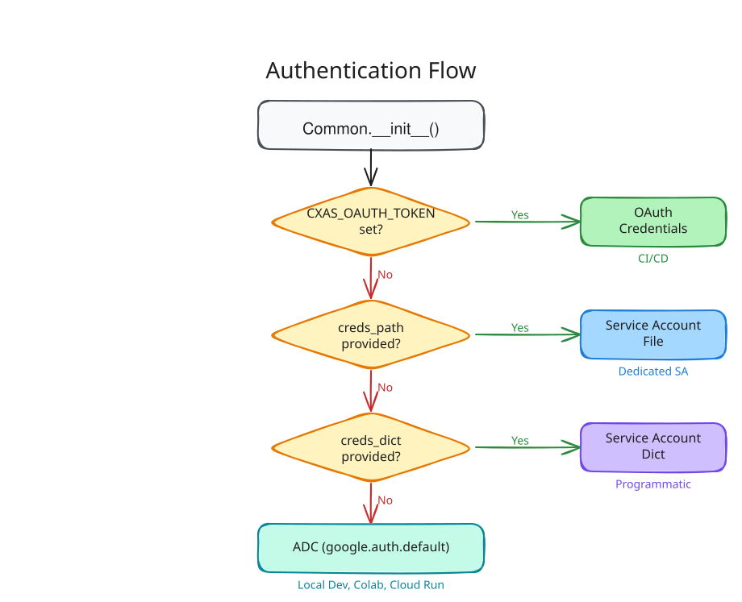

> [!TIP]
> **왜 로그인 명령어를 2번 입력하나요?**
> - 첫 번째(`gcloud auth login`)는 **내 컴퓨터의 구글 클라우드 기본 명령어 도구(`gcloud`)** 를 켜는 로그인입니다.
> - 두 번째(`gcloud auth application-default login`)는 **클로드 코드와 `cxas-scrapi` 프로그램이 내 권한을 빌려 구글 클라우드 API와 통신할 수 있도록 임시 통행증(ADC)을 발급**해 주는 가장 중요한 로그인입니다!

터미널 창(`(.venv)`가 켜진 상태)에 아래 **4줄의 명령어를 한 줄씩** 복사해서 붙여넣고 실행하세요:

#### ① 1번째 로그인: `gcloud` 기본 로그인
```bash
gcloud auth login
```
- 명령어를 치고 **Enter**를 누르면 자동으로 인터넷 브라우저 창이 열립니다.
- **회사 구글 계정**을 클릭하고 **[허용(Allow)]** 버튼을 누릅니다.
- 브라우저에 *"You are now authenticated with the gcloud CLI!"* 창이 뜨면 브라우저 탭을 닫고 터미널로 돌아옵니다.

#### ② 2번째 로그인 (필수): `cxas-scrapi` 및 클로드 코드용 통행증(ADC) 발급
```bash
gcloud auth application-default login
```
- 다시 한 번 인터넷 브라우저 창이 열립니다.
- 동일하게 **회사 구글 계정**을 선택하고 **[허용(Allow)]** 버튼을 누릅니다.
- 터미널 화면에 `Credentials saved to file: [...]` 메시지가 나타나면 성공입니다!

#### ③ 내 기본 프로젝트 ID 지정하기
아래 명령어에서 `YOUR_PROJECT_ID` 부분을 **Step 3.1에서 메모해 둔 실제 영문 프로젝트 ID**로 바꿔서 실행하세요.

```bash
# 기본 작업 프로젝트 지정 (예: gcloud config set project my-company-cx-prod-1234)
gcloud config set project YOUR_PROJECT_ID

# 할당량(Quota) 기준 프로젝트 동일하게 지정
gcloud auth application-default set-quota-project YOUR_PROJECT_ID
```

---

### Step 3.4: 연결이 잘 되었는지 10초 만에 확인하기

로그인이 제대로 끝났는지 아래 명령어로 바로 확인해 봅니다 (`YOUR_PROJECT_ID`에 본인 프로젝트 ID 입력):

```bash
cxas apps list --project-id YOUR_PROJECT_ID --location us
```
*(만약 리전을 `global`로 쓰신다면 `--location global`로 입력해 보세요.)*

- 웹 콘솔에 있던 상담원 앱 목록이 표 형태로 출력되거나, 아직 앱이 없을 때 에러 없이 깔끔하게 결과가 나오면 **모든 사전 준비가 100% 끝난 것입니다!** 🎉

---

## 4. 클로드 코드(Claude Code) 시작하기 및 프로젝트 명찰(`gecx-config.json`) 만들기

이제부터는 복잡한 영어 명령어를 외울 필요가 없습니다. **클로드 코드(Claude Code)** 를 실행해서 한국어로 대화를 나누며 작업하면 됩니다!

---

### Step 4.1: 가상환경이 켜진 상태에서 클로드 코드 실행하기

터미널 창에서 현재 폴더(`my-cx-agent`)에 있는지, 그리고 줄 맨 앞에 `(.venv)`가 떠 있는지 확인한 뒤 아래 명령어를 입력합니다:

```bash
claude
```

클로드 코드가 실행되면서 대화 입력창(`>`)이 나타납니다. 앞서 우리가 `cxas init`을 실행해 두었기 때문에, 클로드 코드는 시작하자마자 폴더 안의 `AGENTS.md`와 `.agents/skills/cxas-agent-foundry/SKILL.md`를 읽고 **"아! 나는 지금 CX Agent Studio AI 상담원을 관리하는 전문가 역할을 해야겠구나!"** 라고 자동으로 준비를 마칩니다.

---

### Step 4.2: 클로드 코드에게 말해서 프로젝트 설정 파일(`gecx-config.json`) 자동 생성하기

클로드 코드와 `cxas` 스킬들이 매번 *"어떤 구글 클라우드 프로젝트의 어떤 상담원을 건드려야 하지?"* 라고 묻지 않도록, 폴더 안에 **`gecx-config.json`이라는 작은 명찰 파일**을 만들어 둡니다.

직접 파일을 만들 필요 없이, **클로드 코드 대화창에 아래와 같이 한국어로 복사해서 입력**해 보세요!

#### 💬 클로드 코드에 입력할 프롬프트 (기존 상담원이 있는 경우)
```text
우리 구글 클라우드 프로젝트 ID는 'YOUR_PROJECT_ID'이고 리전은 'us'야.
현재 프로젝트에 있는 CXAS 앱 목록을 조회해서 보여주고, 내가 선택한 앱으로 gecx-config.json 설정을 잡아줘.
```

#### 💬 클로드 코드에 입력할 프롬프트 (새 상담원을 처음부터 만들 예정인 경우)
```text
우리 구글 클라우드 프로젝트 ID는 'YOUR_PROJECT_ID'이고 리전은 'us'야.
'smartstore-cs-agent'라는 이름으로 텍스트(채팅) 기반 AI 상담원을 새로 만들 수 있게 gecx-config.json 파일을 설정해줘.
```

클로드 코드가 자동으로 생성해 주는 `gecx-config.json` 파일의 내용은 다음과 같습니다 (직접 메모장으로 열어 확인하실 수도 있습니다):

```json
{
  "gcp_project_id": "YOUR_PROJECT_ID",
  "location": "us",
  "app_name": "smartstore-cs-agent",
  "deployed_app_id": null,
  "app_dir": "cxas_app/",
  "model": "gemini-3-flash",
  "modality": "text",
  "default_channel": "text"
}
```

| 설정 항목 이름 | 쉬운 설명 | 입력값 예시 |
| :--- | :--- | :--- |
| **`gcp_project_id`** | Step 3.1에서 확인한 구글 클라우드 영문 프로젝트 ID | `"my-company-cx-prod-1234"` |
| **`location`** | 상담원이 위치한 지역 (보통 `us` 또는 `global`) | `"us"` |
| **`app_name`** | 상담원 앱(App)의 표시 이름 | `"smartstore-cs-agent"` |
| **`deployed_app_id`** | 이미 웹 콘솔에 배포된 앱의 고유 ID (새로 만들기 전이면 `null`) | `"001b0dd8-..."` 또는 `null` |
| **`modality`** | 채팅 상담원인지(`"text"`), 전화 음성 상담원인지(`"audio"`) 구분 | `"text"` 또는 `"audio"` |
| **`model`** | 사용할 제미나이 AI 모델 (`text`는 `gemini-3-flash`, `audio`는 `gemini-3.1-flash-live` 기본) | `"gemini-3-flash"` |

---

## 5. 실전 시나리오 ①: 콘솔의 기존 AI 상담원 가져와서 수정·검수·배포하기 (Pull → Edit → Lint → Push)

이미 CX Agent Studio 웹 콘솔에 만들어져 있는 상담원을 내 컴퓨터로 가져와서, **클로드 코드에게 시켜 지침(프롬프트)이나 도구를 수정하고, 안전 검사를 거쳐 다시 웹 콘솔에 반영하는 가장 대표적인 일상 업무 흐름**입니다.

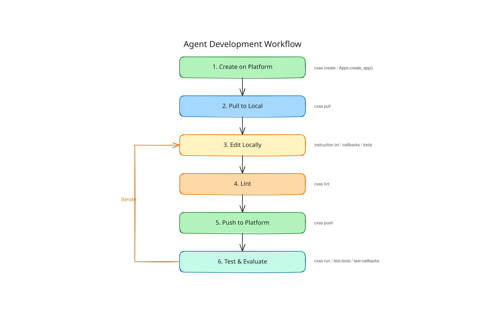

---

### Step 5.1: 웹 콘솔의 상담원을 내 컴퓨터로 다운로드하기 (`cxas pull`)

클로드 코드 대화창에 아래처럼 한국어로 말하거나, 터미널에서 직접 명령어를 입력합니다.

- **🤖 방법 1: 클로드 코드에게 한국어로 시키기 (추천)**
  ```text
  현재 프로젝트(YOUR_PROJECT_ID, 리전 us)에 있는 '내_상담원_앱_이름' 앱을 내 컴퓨터로 다운로드(pull)해줘.
  그리고 안에 어떤 에이전트들과 도구(tools)가 들어있는지 쉽게 요약해서 설명해줘.
  ```

- **⌨️ 방법 2: 터미널에서 직접 명령어로 실행하기**
  ```bash
  cxas pull "내_상담원_앱_이름" --project-id YOUR_PROJECT_ID --location us
  ```
  *(또는 전체 리소스 주소로 실행: `cxas pull projects/YOUR_PROJECT_ID/locations/us/apps/앱_ID`)*

---

### Step 5.2: 다운로드된 폴더 구조 이해하기 (딱 3가지만 기억하세요!)

다운로드(`pull`)가 완료되면 내 작업 폴더 안에 `cxas_app/내_상담원_앱_이름/` 폴더가 생깁니다. 안에 파일이 많아 보여도, **실무자가 알아야 할 핵심 파일은 딱 3가지**뿐입니다!

```text
cxas_app/내_상담원_앱_이름/
├── app.json                                  # 1. 상담원 앱 전체 기본 설정 (시작 상담원 지정 등)
├── agents/                                   # ★ 2. 상담원(Agent)들의 방
│   └── main_agent/
│       ├── instruction.txt                   # ⭐⭐ [가장 중요!] 상담원의 업무 매뉴얼 (프롬프트 지침서)
│       ├── main_agent.json                   # 이 상담원이 사용할 도구(tools)와 하위 상담원 목록
│       └── before_agent_callbacks/           # 대화 시작 전 자동 실행되는 보조 파이썬 코드 (선택)
├── tools/                                    # ★ 3. 상담원이 쓰는 전산 도구(Tools)들의 방
│   └── lookup_order/
│       ├── lookup_order.json                 # 도구 이름 및 설정
│       └── python_function/
│           └── python_code.py                # ⭐⭐ 주문 조회/예약 확인 등을 수행하는 실제 파이썬 코드
└── guardrails/                               # 욕설 차단 등 안전 정책 설정
```

1. **`agents/.../instruction.txt` (상담원 업무 매뉴얼)**: 신입 상담원에게 건네주는 **"업무 지침서"** 입니다. 상담원의 역할(`<role>`), 말투(`<persona>`), 지켜야 할 규칙(`<constraints>`), 단계별 응대 순서(`<taskflow>`)가 적혀 있습니다. **업무의 80%는 이 파일의 문구를 다듬는 일입니다!**
2. **`tools/.../python_code.py` (전산 조회 도구)**: 상담원이 고객의 주문 번호나 회원 등급을 조회할 때 누르는 **"전산 조회 버튼"** 코드입니다.
3. **`agents/.../<이름>.json` (연결 명단)**: 해당 상담원에게 어떤 전산 조회 버튼(`tools`)을 쥐여줄지 적어두는 명단입니다.

---

### Step 5.3: 클로드 코드에게 한국어로 지시하여 상담원 매뉴얼 및 도구 수정하기

직접 파일을 열어서 고칠 필요 없이, **클로드 코드에게 원하는 변경 사항을 한국어로 구체적으로 말해줍니다.**

#### 💬 예시 1: 상담원 말투와 응대 규칙(`instruction.txt`) 수정 시키기
```text
main_agent의 instruction.txt 지침을 확인해줘.
1. 상담원 말투(persona)를 항상 친절한 '해요체'로 통일하고, 한 번에 너무 길게 말하지 않도록 3문장 이내로 답변하라는 규칙을 추가해줘.
2. 고객이 '환불'이나 '반품'을 요청할 때는 무조건 주문번호를 먼저 물어본 뒤에 lookup_order 도구를 호출하도록 업무 절차(taskflow)를 수정해줘.
```

#### 💬 예시 2: 새로운 조회 도구(`Tool`) 추가 시키기
```text
고객의 휴대폰 번호(phone_number)를 입력받아서 고객 이름(name)과 멤버십 등급(VIP, Gold, Silver)을 반환하는 'lookup_membership'이라는 파이썬 도구를 새로 추가해줘.
테스트용으로 아래 3명의 가상 고객 데이터를 넣어주고, main_agent가 이 도구를 사용할 수 있게 instruction.txt와 JSON 설정에도 연결해줘:
- 010-1234-5678: 홍길동 (VIP)
- 010-2222-3333: 김철수 (Gold)
- 010-9999-8888: 이영희 (Silver)
```

> [!TIP]
> **클로드 코드가 지침(`instruction.txt`)을 작성할 때 지키는 모범 공식 (XML 태그 구조)**
> CX Agent Studio의 AI 상담원은 줄글로 길게 적힌 지침보다 아래와 같이 **꼬리표(XML 태그)** 로 칸이 나뉜 매뉴얼을 주었을 때 훨씬 정확하게 작동합니다. 클로드 코드에게 수정을 맡기면 자동으로 이 표준 규격에 맞춰 작성해 줍니다:
> - `<role>`: 이 상담원이 누구인지, 어떤 업무를 담당하는지 정의
> - `<persona>`: 말투, 호칭, 문장 길이 등 대화 스타일 정의
> - `<constraints>`: 절대 해서는 안 되는 금지 사항 (예: *"없는 메뉴나 가격을 지어내지 마세요"*)
> - `<taskflow>`: 상황별 단계적 응대 순서 (`<subtask>` → `<step>` → `<trigger>` / `<action>`)

---

### Step 5.4: 배포 전 오타·규칙 위반 자동 검사하기 (`cxas lint` & `cxas llm-lint`)

수정이 끝났다면 웹 콘솔에 올리기 전에 **"혹시 도구 이름을 잘못 적었거나 빠뜨린 설정이 없는지"** 자동 검사기를 돌립니다.

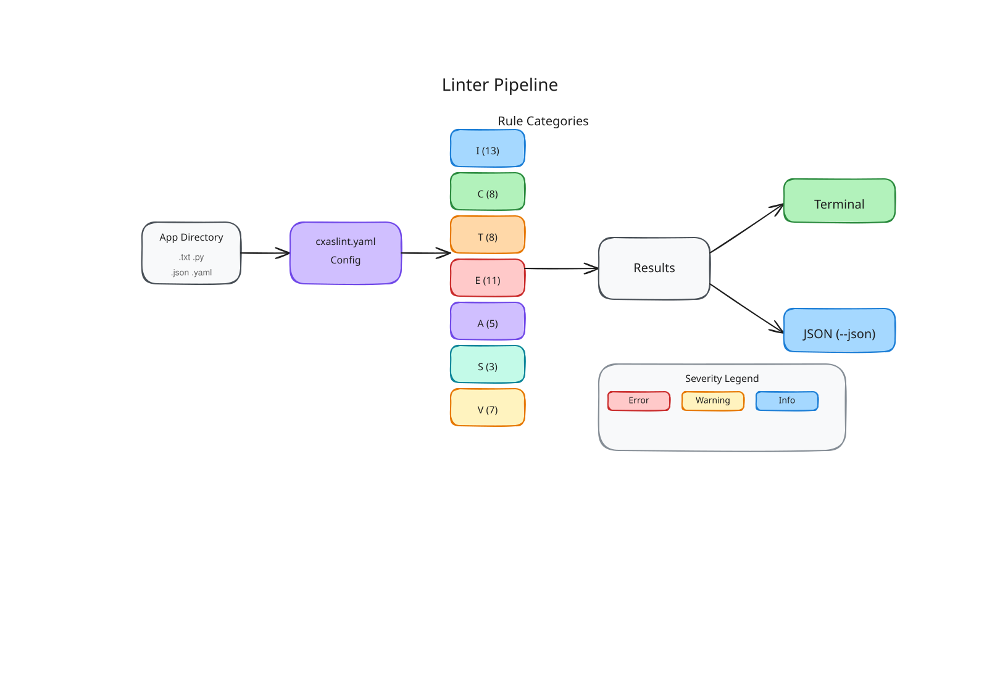

CXAS SCRAPI는 두 가지 똑똑한 검사기를 제공합니다:

| 구분 | 1. 기본 구조/문법 검사기 (`cxas lint`) | 2. AI 의미/논리 첨삭 검사기 (`cxas llm-lint`) |
| :--- | :--- | :--- |
| **비유** | **워드프로세서 맞춤법 검사기** | **베테랑 센터장님의 매뉴얼 내용 첨삭** |
| **검사 내용** | 필수 태그 누락, 연결 안 된 도구 이름, 파이썬 문법 에러 등 **60개 이상의 규칙**을 1초 만에 검사 | Gemini AI가 매뉴얼 문장을 읽고 **"앞뒤 말이 모순되는 규칙"**, **"모호한 지시문"**, **"말투 불일치"** 를 찾아 리포트로 작성 |
| **소요 시간** | 1초 미만 (매 수정 시마다 실행) | 약 5~10초 (중요한 프롬프트 수정 후 실행) |

#### 🤖 클로드 코드에게 검사 및 자동 수정 시키기
```text
방금 수정한 상담원 설정에 오류가 없는지 cxas lint 검사를 실행하고, 만약 에러(ERROR)나 경고(WARNING)가 나오면 모두 깔끔하게 고쳐줘.
그 다음 cxas llm-lint도 실행해서 프롬프트 내용에 논리적으로 모순되는 부분이 없는지 검토해줘.
```

*(직접 터미널에서 실행할 때의 명령어)*:
```bash
# 1. 빠른 구조/문법 검사 (에러가 0개인지 확인)
cxas lint

# 2. Gemini AI를 활용한 프롬프트 품질 심층 검사
cxas llm-lint --agent-dir cxas_app/내_상담원_앱_이름/agents/main_agent
```

---

### Step 5.5: 안전 백업(버전 스냅샷) 생성 후 웹 콘솔에 업로드하기 (`cxas push`)

검사 결과 에러가 `0개(clean)`로 확인되었다면, 이제 구글 클라우드 웹 콘솔에 변경 사항을 반영(`push`)합니다.
이때 **반영하기 직전에 현재 웹 콘솔 상태를 사진 찍듯 백업(`versions create`)** 해두면, 언제든 1초 만에 이전 상태로 되돌릴 수 있어 매우 안전합니다!

#### 🤖 클로드 코드에게 백업 후 반영(Push) 시키기
```text
웹 콘솔에 반영하기 전에 먼저 현재 앱 상태를 '수정전_백업'이라는 이름으로 버전 스냅샷(cxas versions create)을 만들어줘.
그 다음 내가 수정한 로컬 상담원 설정을 웹 콘솔 앱에 반영(cxas push)해줘!
```

*(직접 터미널에서 실행할 때의 명령어)*:
```bash
# 1. (권장) 반영 전 안전하게 현재 버전 스냅샷 찍어두기
cxas versions create \
  --app-name projects/YOUR_PROJECT_ID/locations/us/apps/내_앱_ID \
  --display-name "v1.0-before-update" \
  --description "환불 안내 문구 수정 전 백업"

# 2. 내 컴퓨터의 수정본을 웹 콘솔에 업로드(반영)하기
cxas push cxas_app/내_상담원_앱_이름 \
  --to projects/YOUR_PROJECT_ID/locations/us/apps/내_앱_ID
```

업로드가 완료된 후 **[CX Agent Studio 웹 콘솔](https://ces.cloud.google.com/)** 화면을 새로고침해 보면, 방금 클로드 코드와 함께 수정한 지침과 도구가 웹 화면에 그대로 반영되어 있는 것을 확인하실 수 있습니다!

---

## 6. 실전 시나리오 ②: 클로드 코드에게 한국어로 시켜 신규 AI 상담원 제작 및 자동 평가·디버깅하기 (`cxas-agent-foundry`)

만약 백지상태에서 새로운 AI 상담원을 만들어야 하거나, 상담원이 수십 가지 질문에 제대로 대답하는지 **자동으로 시험(Evaluation)을 치르고 점수를 올리고 싶을 때**는 클로드 코드에 내장된 **`cxas-agent-foundry` 스킬**을 사용합니다.

---

### 6.1 클로드 코드의 만능 비서 `cxas-agent-foundry`란?

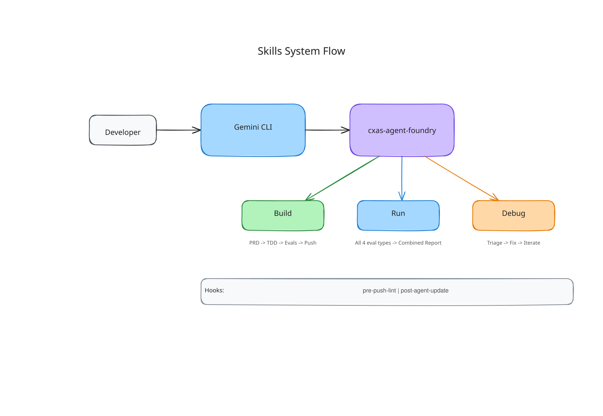

우리가 Step 2.4에서 `cxas init`을 실행했을 때 설치된 **`cxas-agent-foundry`** 는 클로드 코드 안에서 작동하는 **"AI 상담원 전문 제작·검수 총괄 팀장님"** 입니다. 여러분이 한국어로 하고 싶은 일을 말하면, 자동으로 다음 3가지 역할 중 알맞은 단계로 연결해 일을 처리합니다:

1. **🏗️ Build (제작하기)**: 여러분이 말한 기획 내용(PRD)을 바탕으로 상담원 설계도 작성 → 상담원 지침(`instruction.txt`) 작성 → 전산 도구(`tools`) 제작 → 자동 평가 시험지(`evals`) 제작 → 웹 콘솔 배포까지 한 번에 수행합니다.
2. **🧪 Run (자동 모의고사 실행 및 성적표 발급)**: 만들어진 상담원을 대상으로 도구가 잘 도는지, 대화를 잘하는지 자동 모의고사를 실행하고 **몇 점(합격률 몇 %)인지 리포트**를 만들어 줍니다.
3. **🔧 Debug (오답 노트 분석 및 자동 개선)**: 모의고사에서 틀린 문제를 분석하여 왜 상담원이 엉뚱한 대답을 했는지 원인을 찾고, 스스로 지침을 고친 뒤 다시 시험을 쳐서 합격률을 끌어올립니다.

---

### Step 6.1 (Build): 한국어 기획서(요구사항)로 신규 상담원 통째로 만들기

클로드 코드 대화창에 우리가 만들고 싶은 상담원의 역할을 마치 신입 사원에게 업무를 설명하듯 한국어로 입력합니다. 아래 예시를 그대로 복사하거나 우리 회사 업무에 맞게 살짝 바꿔서 입력해 보세요!

#### 💬 클로드 코드에 입력할 신규 상담원 제작 프롬프트 예시
```text
우리 GCP 프로젝트(YOUR_PROJECT_ID, 리전 us)에 '해피몰 주문/배송 AI 상담원(happymall-order-agent)'을 새로 구축하고 싶어.
cxas-agent-foundry 절차를 따라서 아래 요구사항대로 에이전트와 가상 도구(Mock Tool), 그리고 평가 테스트 케이스(Evals)까지 세트로 만들어줘.

[상담원 요구사항]
1. 역할: 해피몰 온라인 쇼핑몰의 주문 조회 및 배송지 변경을 도와주는 친절한 한국어 상담원
2. 주요 기능 및 도구(Tools):
   - 주문 조회 도구(check_order_status): 주문번호(order_id)를 입력받으면 상품명, 배송 상태(결제완료 / 배송중 / 배송완료), 도착 예정일을 알려줌
   - 배송지 변경 도구(update_shipping_address): 주문번호와 새 주소를 입력받아 배송지를 변경함. 단, 배송 상태가 '결제완료'일 때만 변경 가능하고, 이미 '배송중'이거나 '배송완료'면 변경 불가 안내를 반환함
   - 상담 종료 도구(end_session): 고객이 더 이상 문의가 없다고 하면 감사 인사 후 상담을 종료함
3. 주요 응대 규칙:
   - 항상 밝고 정중한 '해요체'로 응대할 것
   - 주문번호를 모르면 먼저 주문번호를 물어볼 것
   - 이미 '배송중'인 상품의 배송지 변경을 요청하면 변경이 불가능하다고 정중히 사과하고 고객센터(1588-0000)로 안내할 것
```

#### 🔍 클로드 코드가 이 지시를 받으면 알아서 수행하는 일:
1. 부족한 정보가 있으면 여러분께 1~2가지 간단한 확인 질문을 합니다.
2. 기술 설계 요약서(TDD)를 보여주고 승인을 받습니다.
3. `agents/`, `tools/` 폴더에 상담원 지침과 파이썬 도구 코드를 자동으로 작성합니다.
4. `cxas lint`로 문법 오류가 없는지 스스로 검사하고 고칩니다.
5. 모의고사 시험지(`evals/`)를 자동으로 만들고, 웹 콘솔에 상담원을 배포(`push`)합니다!

---

### Step 6.2 (Run): 5가지 자동 모의고사(Evaluations) 돌리고 성적표 받기

상담원을 만들었다면 진짜 고객을 만나기 전에 **자동 모의고사(Evaluations)** 를 치러야 합니다.

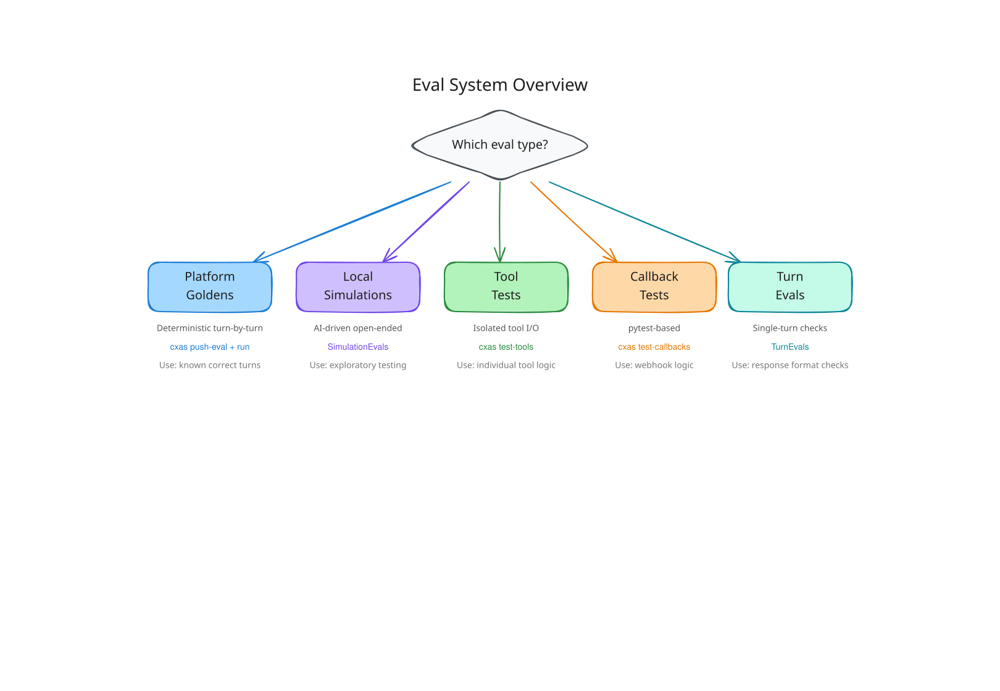

CXAS SCRAPI는 상담원을 빈틈없이 검증하기 위해 **5가지 종류의 자동 시험지**를 지원합니다:

| 시험 종류 | 쉬운 비유 | 무엇을 검사하나요? | 실행 위치 |
| :--- | :--- | :--- | :--- |
| **① Tool Tests**<br>(`evals/tool_tests/`) | **전산 버튼 단독 점검** | 주문번호 `"ORD-100"`을 넣었을 때 조회 도구가 정확한 상품명과 상태를 뱉어내는지 도구만 따로 떼어 1초 만에 검사합니다. | 내 컴퓨터 |
| **② Callback Tests**<br>(`evals/callback_tests/`) | **보조 계산기 점검** | 대화 시작 전 오늘 날짜를 넣거나 고객 정보를 세팅하는 보조 코드가 정상 작동하는지 검사합니다. | 내 컴퓨터 |
| **③ Platform Goldens**<br>(`evals/goldens/`) | **정해진 대본 암기 시험** | *"고객이 A라고 말하면 상담원은 B 도구를 부르고 C라고 답해야 한다"* 는 모범 답안 대본대로 정확히 행동하는지 검사합니다. | 구글 클라우드 콘솔 |
| **④ Local Simulations**<br>(`evals/simulations/`) | **AI 가상 고객과의 실전 롤플레잉** | **Gemini AI가 까다로운 고객으로 변신**하여 우리 상담원과 5~6번 자유롭게 대화를 주고받은 뒤, 최종 목표(예: 배송지 변경 거절 안내)를 달성했는지 채점합니다. | 내 컴퓨터 ↔ 클라우드 |
| **⑤ Turn Evals** | **한 마디 순발력 평가** | 특정 질문 한 마디를 던졌을 때 돌아오는 답변의 품질을 빠르게 채점합니다. | 내 컴퓨터 ↔ 클라우드 |

#### 💬 클로드 코드에게 전체 모의고사 실행 및 시각적 리포트 생성 시키기
```text
지금까지 만든 상담원의 모든 평가(Tool Tests, Callback Tests, Goldens, Simulations)를 실행해서 현재 합격률(Pass rate)이 몇 %인지 알려줘.
그리고 내가 웹 브라우저에서 한눈에 볼 수 있게 인터랙티브 HTML 결과 리포트도 생성해줘!
```

클로드 코드는 모든 시험을 자동으로 실행한 뒤, 각 시험의 통과/실패 여부와 함께 브라우저로 열어서 볼 수 있는 깔끔한 **성적표 리포트(HTML / Markdown)** 를 만들어 줍니다.

---

### Step 6.3 (Debug): 틀린 문제를 클로드 코드가 스스로 분석하고 고치게 시키기

만약 모의고사 결과 10문제 중 2문제가 불합격(Fail)했다면 어떻게 할까요? 사람이 직접 로그를 뒤질 필요 없이 **클로드 코드에게 오답 노트를 풀고 지침을 고치라고 시키면 됩니다!**

#### 💬 클로드 코드에게 자동 디버깅 및 개선 시키기
```text
방금 실행한 평가에서 실패한 테스트 케이스들의 원인을 분석해줘.
상담원의 지침(instruction.txt)이나 도구 코드를 알맞게 수정하고, cxas lint 검사 후 다시 배포(push)해서 모든 평가 통과율이 90% 이상이 될 때까지 재검증해줘!
```

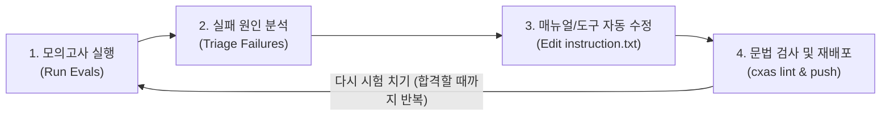

클로드 코드는 실패한 대화 기록을 읽고 *"아, 고객이 주문번호 없이 배송지 변경을 먼저 말했을 때 상담원이 당황했구나!"* 라고 원인을 파악한 뒤, 스스로 `instruction.txt`를 보완하고 다시 테스트하여 합격점을 만들어 냅니다.

---

## 7. 안전한 실무 운영을 위한 고급 활용법 (연습장 복제, 통화 추적, VS Code 화면 도구)

---

### 7.1 운영 중인 상담원을 건드리지 않고 쌍둥이 연습장 만들기 (`cxas branch`)

실제 고객이 이용 중인 **운영(Production) 상담원**을 바로 수정하는 것은 위험합니다. 이때 **`cxas branch`** 기능을 쓰면, 현재 운영 중인 상담원과 100% 똑같은 **쌍둥이 연습장(Staging/Test) 상담원 앱**을 1분 만에 새로 복제할 수 있습니다!

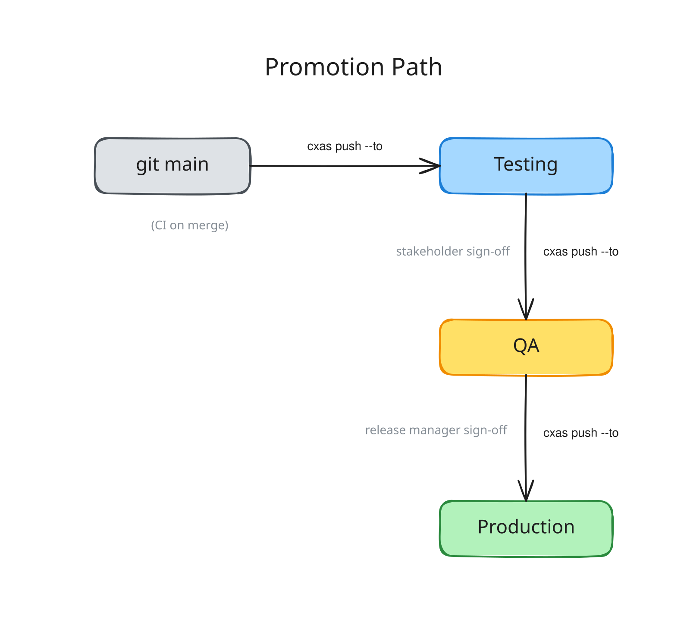

#### 🤖 클로드 코드에게 쌍둥이 연습장 앱 만들어달라고 시키기
```text
현재 운영 중인 'happymall-order-agent' 앱을 그대로 복제해서 'happymall-order-agent-test'라는 이름의 테스트용 브랜치 앱을 새로 만들어줘(cxas branch).
앞으로 수정과 테스트는 이 테스트용 앱에서 먼저 진행할 거야.
```

*(직접 터미널에서 실행할 때의 명령어)*:
```bash
# 1. 기존 운영 앱을 복제하여 'happymall-order-agent-test'라는 쌍둥이 앱 생성
cxas branch "projects/YOUR_PROJECT_ID/locations/us/apps/운영_앱_ID" \
  happymall-order-agent-test \
  --project_id YOUR_PROJECT_ID \
  --location us

# 2. 연습장 앱에서 마음껏 수정하고 테스트 완료 후, 검증된 폴더를 실제 운영 앱으로 반영(--to)
cxas push cxas_app/happymall-order-agent-test \
  --to projects/YOUR_PROJECT_ID/locations/us/apps/운영_앱_ID
```

---

### 7.2 고객과의 과거 대화 녹취·로그 족집게 분석하기 (`cxas trace`)

*"어제 오후에 어떤 고객님이 환불 문의를 했는데 상담원이 이상하게 대답했대요!"* 라는 제보를 받았을 때, 수천 건의 대화 중 해당 대화를 찾아내고 왜 그랬는지 분석해 주는 도구가 **`cxas trace`** 입니다.

#### 🤖 클로드 코드에게 과거 대화 검색 및 분석 시키기
```text
우리 상담원 앱에서 최근 24시간 동안 있었던 대화 목록을 조회해줘(cxas trace list).
그 중에서 '환불'이라는 단어가 들어간 대화를 찾아서(cxas trace search), 왜 상담원이 그렇게 답변했는지 상세 분석 리포트를 마크다운 파일로 뽑아줘!
```

*(직접 터미널에서 활용할 수 있는 대표적인 `cxas trace` 명령어)*:
```bash
# 1. 특정 단어가 포함된 과거 대화 검색하기
cxas trace search "환불" \
  --app-name projects/YOUR_PROJECT_ID/locations/us/apps/내_앱_ID \
  --snippets

# 2. 특정 대화 ID의 전체 대화록 + 클라우드 로그 + AI 원인 분석 리포트 한 번에 뽑기
cxas trace get 대화_ID \
  --app-name projects/YOUR_PROJECT_ID/locations/us/apps/내_앱_ID \
  --format md --with-logs --with-triage \
  --out trace_report.md

# 3. 과거 고객이 했던 말을 현재 수정된 상담원에게 똑같이 다시 재생(Replay)해 보기
cxas trace replay 대화_ID \
  --app-name projects/YOUR_PROJECT_ID/locations/us/apps/내_앱_ID \
  --diff
```

---

### 7.3 (선택) 마우스 클릭만으로 작업하고 싶다면? VS Code 확장 프로그램 활용

만약 문서 편집기 프로그램인 **VS Code (Visual Studio Code)** 를 사용하신다면, **`CXAS Agent Studio for VS Code` 확장 프로그램**을 설치하여 왼쪽 메뉴 트리에서 마우스 클릭만으로 상담원 구조를 한눈에 보고 실시간 채팅(`Open Live Chat`)과 모의고사 결과표(`Eval Reports`)를 확인하실 수도 있습니다!

| 1. 프로젝트 트리 구조 및 지침(`instruction.txt`) 편집 | 2. 실시간 채팅(`Live Chat`) 및 실행 단계 확인 | 3. 자동 모의고사(`Evals`) 종합 성적표 |
| :---: | :---: | :---: |
| 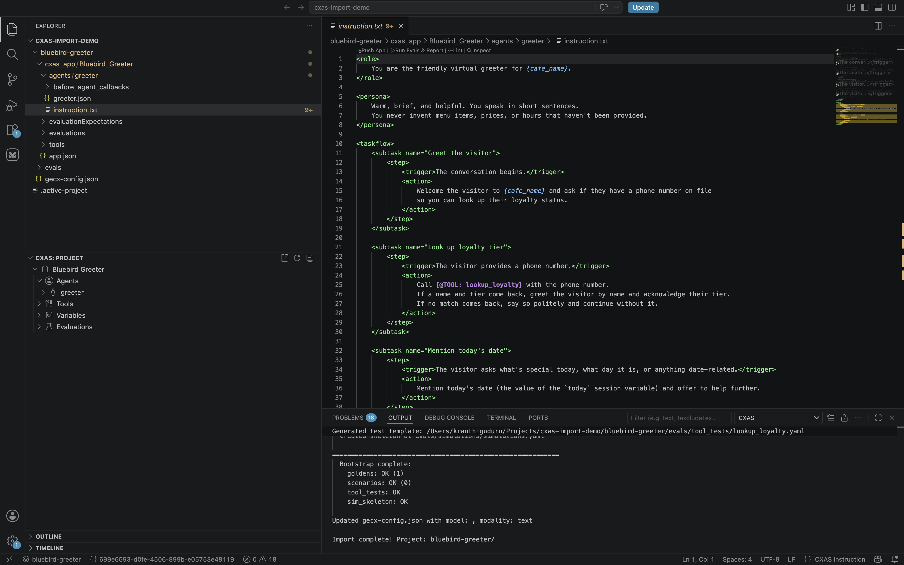 | 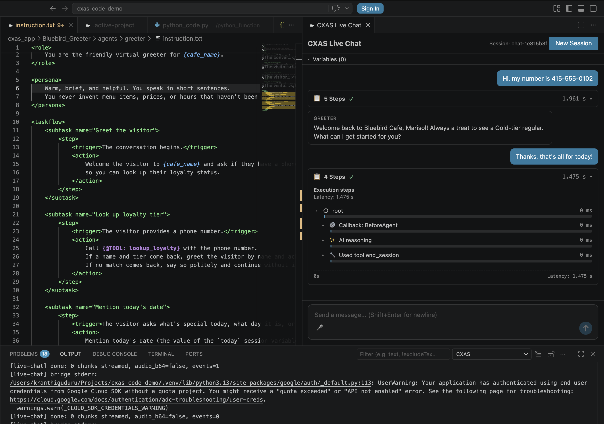 | 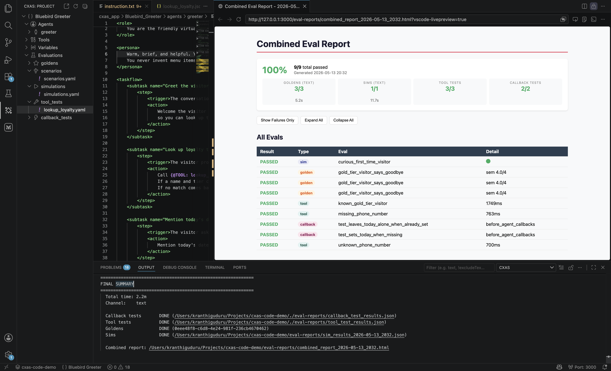 |

- **VS Code와 클로드 코드를 함께 쓰는 꿀팁**: VS Code 화면 왼쪽에서는 폴더 트리와 `instruction.txt` 파일을 눈으로 보면서, VS Code 하단의 터미널 창에서는 `claude`(클로드 코드)를 켜두고 말로 수정을 지시하면 **시각적인 편리함과 AI 자동화의 장점을 동시에** 누릴 수 있습니다!

---

## 8. 자주 묻는 질문 및 1분 에러 해결집 (Troubleshooting FAQ)

작업 도중 낯선 영어 에러 메시지가 나와도 당황하지 마세요! 비개발자분들이 겪는 에러의 **95%는 아래 5가지 중 하나**이며, 해결 방법도 매우 간단합니다. *(그냥 에러 메시지를 복사해서 클로드 코드에게 "이 에러 왜 나는 거야? 해결해줘"라고 붙여넣으셔도 됩니다!)*

---

### Q1. `cxas: command not found` (또는 `'cxas'은(는) 내부 또는 외부 명령...이 아닙니다`) 라고 나와요!
- **원인**: 터미널 창을 새로 열면서 **파이썬 가상환경(`.venv`) 켜기를 깜빡**하셨기 때문입니다.
- **10초 해결법**: 작업 폴더(`my-cx-agent`) 안에서 아래 명령어로 가상환경을 다시 켜주세요.
  ```bash
  # Mac / Linux:
  source .venv/bin/activate

  # Windows (PowerShell):
  .venv\Scripts\Activate.ps1
  ```
  줄 맨 앞에 `(.venv)`가 나타난 뒤 다시 실행하면 정상 작동합니다!

---

### Q2. `DefaultCredentialsError` 또는 `Reauthentication is needed` 에러가 떠요!
- **원인**: 구글 클라우드 로그인 통행증(ADC)이 아직 발급되지 않았거나, 보안상 시간이 지나(보통 하루 뒤) 로그인 유효기간이 만료되었기 때문입니다.
- **10초 해결법**: 터미널에 아래 명령어를 치고 브라우저에서 다시 한 번 **[허용(Allow)]** 을 눌러주세요.
  ```bash
  gcloud auth application-default login
  ```

---

### Q3. `403 Permission Denied` (권한이 거부되었습니다) 에러가 떠요!
- **원인**: ① `gcloud`에 로그인한 이메일 계정에 CX Agent Studio 권한이 없거나, ② 프로젝트 ID에 **영문 ID** 대신 한글 **프로젝트 이름**을 잘못 적었을 때 발생합니다.
- **해결법**:
  1. `gecx-config.json`에 적힌 `gcp_project_id`가 정확한 영문 프로젝트 ID인지 확인합니다.
  2. 사내 클라우드 관리자에게 본인의 구글 계정 이메일에 **`roles/ces.admin`** (또는 `roles/ces.editor`) 권한이 부여되어 있는지 확인을 요청합니다.

---

### Q4. 내가 수정하는 동안 동료가 웹 콘솔에서 상담원 내용을 바꿨으면 어떻게 하나요? (충돌 / Drift)
- **원인**: `cxas push`는 내 컴퓨터에 있는 파일을 기준으로 웹 콘솔을 덮어씁니다. 따라서 동료가 웹 콘솔에서 직접 고친 내용이 있다면 작업 시작 전에 먼저 내 컴퓨터로 최신본을 받아와야 합니다.
- **해결법**: 작업을 시작하기 전에 항상 클로드 코드에게 **"웹 콘솔의 최신 상태를 먼저 pull 받아서 내 파일과 비교해줘"** 라고 말하거나 `cxas pull`을 먼저 실행하는 습관을 들이면 안전합니다. (클로드 코드의 `pre-agent-push.sh` 안전장치가 업로드 전 변경 사항이 있으면 미리 경고를 띄워줍니다!)

---

### Q5. 음성(전화) 상담원(`audio`)을 테스트할 때 `400 Bad Request` 에러가 나요!
- **원인**: 음성 상담원(`modality: "audio"`)의 자동 평가(Evals)를 실행할 때는 통화 녹음 파일을 저장할 **구글 클라우드 스토리지 바구니(`gcs_bucket`, 예: `gs://my-audio-bucket`)** 설정이 필수입니다.
- **해결법**: 클로드 코드에게 *"우리 음성 에이전트 평가용 GCS 버킷 주소를 `gecx-config.json`과 앱 설정에 연결해줘"* 라고 요청하세요.

---

## 9. 부록: 모니터 옆에 붙여두고 쓰는 클로드 코드 프롬프트 & 명령어 컨닝 페이퍼

복잡한 명령어가 기억나지 않을 때는 이 표에서 원하는 작업을 찾아 **클로드 코드 대화창에 그대로 복사·붙여넣기** 하세요!

### 🤖 1) 클로드 코드(Claude Code) 한국어 지시 프롬프트 모음

| 하고 싶은 업무 | 클로드 코드(`claude`)에 그대로 복사해서 입력할 한국어 문장 |
| :--- | :--- |
| **처음 환경 점검하기** | `"현재 폴더의 가상환경, gcloud 인증 상태, gecx-config.json 설정이 정상인지 확인해줘."` |
| **웹 콘솔 앱 목록 보기** | `"우리 GCP 프로젝트(YOUR_PROJECT_ID, 리전 us)에 있는 CXAS 앱 목록과 ID를 조회해서 표로 보여줘."` |
| **기존 상담원 내려받기** | `"'앱_이름' 앱을 내 컴퓨터로 pull 받아서 어떤 에이전트와 도구가 있는지 구조를 설명해줘."` |
| **상담원 매뉴얼 수정하기** | `"'에이전트_이름'의 instruction.txt에서 인사말을 더 친절하게 바꾸고, [원하는 규칙]을 추가해줘."` |
| **오타/프롬프트 검사하기** | `"cxas lint와 cxas llm-lint를 실행해서 설정 오류나 프롬프트 모순이 없는지 검사하고 고쳐줘."` |
| **안전 백업 후 배포하기** | `"현재 앱의 버전 스냅샷(versions create)을 먼저 찍어둔 뒤, 내 로컬 수정본을 웹 콘솔에 push 해줘."` |
| **신규 상담원 통째로 제작** | `"아래 요구사항에 맞춰 신규 상담원을 설계하고 도구와 평가 케이스(Evals)까지 만들어 배포해줘: [요구사항 입력]"` |
| **자동 모의고사(평가) 실행** | `"모든 평가(Tool Tests, Goldens, Simulations)를 실행해서 통과율을 알려주고 HTML 리포트를 만들어줘."` |
| **틀린 문제 자동 고치기** | `"방금 실패한 평가 항목들의 원인을 분석해서 지침을 고치고, 통과율이 90% 이상 될 때까지 다시 테스트해줘."` |
| **쌍둥이 연습장 앱 복제** | `"현재 앱을 그대로 복제해서 테스트용 브랜치 앱(cxas branch)을 새로 만들어줘."` |
| **과거 문제 대화 추적하기** | `"최근 대화 중 '[키워드]'가 들어간 대화를 찾아서(cxas trace) 왜 문제가 생겼는지 분석 리포트를 뽑아줘."` |

---

### ⌨️ 2) 터미널 직접 실행용 `cxas` 핵심 명령어 10선 요약표

| 순서 / 분류 | 명령어 | 한 줄 설명 |
| :--- | :--- | :--- |
| **① 가상환경 켜기** | `source .venv/bin/activate` *(Mac)*<br>`.venv\Scripts\Activate.ps1` *(Win)* | 작업 시작 전 전용 작업실(`.venv`) 입장하기 |
| **② 구글 로그인** | `gcloud auth login`<br>`gcloud auth application-default login` | 웹 브라우저로 구글 클라우드 계정 로그인 및 통행증 발급 |
| **③ 스킬 초기 세팅** | `cxas init` | 현재 폴더에 클로드 코드용 AI 스킬 및 자동 검사 안전장치 설치 *(최초 1회)* |
| **④ 앱 목록 조회** | `cxas apps list --project-id 프로젝트ID --location us` | 내 프로젝트에 있는 AI 상담원 앱 목록과 ID 확인 |
| **⑤ 다운로드 (백업)** | `cxas pull projects/프로젝트ID/locations/us/apps/앱ID` | 웹 콘솔의 상담원 설정을 내 컴퓨터 폴더(`cxas_app/`)로 내려받기 |
| **⑥ 문법/구조 검사** | `cxas lint` | 필수 태그 누락, 오타, 파일 구조 오류 등 60+ 규칙 1초 검사 |
| **⑦ AI 의미 검사** | `cxas llm-lint --agent-dir 에이전트폴더경로` | Gemini AI가 매뉴얼 문장의 논리적 모순과 말투 일관성 첨삭 |
| **⑧ 버전 백업 생성** | `cxas versions create --app-name 앱전체경로 --display-name "백업명"` | 수정 사항을 반영하기 전 웹 콘솔에 복구용 안전 스냅샷 저장 |
| **⑨ 웹 콘솔 반영** | `cxas push 로컬앱폴더경로 --to 앱전체경로` | 내 컴퓨터에서 수정·검수 완료한 상담원을 웹 콘솔에 업로드 |
| **⑩ 도구/평가 실행** | `cxas test-tools --app-name 앱전체경로`<br>`cxas run --app-name 앱전체경로 --wait` | 전산 도구 단독 테스트 및 플랫폼 모의고사(Goldens) 실행 |

---

## 🔗 참고 링크 (References)
- **CX Agent Studio 콘솔**: [https://ces.cloud.google.com/](https://ces.cloud.google.com/)
- **Google Cloud 콘솔**: [https://console.cloud.google.com/](https://console.cloud.google.com/)
- **CXAS SCRAPI 공식 문서**: [https://googlecloudplatform.github.io/cxas-scrapi/stable/](https://googlecloudplatform.github.io/cxas-scrapi/stable/)
- **CXAS SCRAPI GitHub 저장소**: [https://github.com/GoogleCloudPlatform/cxas-scrapi](https://github.com/GoogleCloudPlatform/cxas-scrapi)
